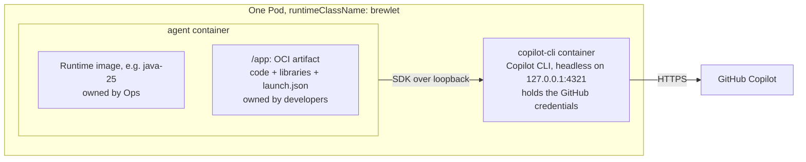

# Brewlet agents

[](https://github.com/brunoborges/brewlet-agents/actions/workflows/ci.yml)
[](https://github.com/brunoborges/brewlet-agents/actions/workflows/e2e.yml)
[](https://github.com/brunoborges/brewlet-agents/actions/workflows/pages.yml)


[Microsoft Copilot SDK](https://github.com/microsoft/copilot-sdk) agents in Java, Node.js, Python and
.NET, deployed to a local Kubernetes cluster (`kind`) with [Brewlet](https://github.com/microsoft/brewlet),
and documented end to end for demos, blog posts, videos and workshops.

The agents use the Microsoft SDK packages: `com.microsoft:copilot-sdk` (Java),
`@microsoft/copilot-sdk` (Node.js), `microsoft-copilot-sdk` (Python) and `Microsoft.Copilot.SDK` (.NET).
The separate [Copilot CLI](https://github.com/github/copilot-cli) sidecar still comes from
`github/copilot-cli`; it is not the SDK dependency.

The point of the project is **who owns what**. Brewlet lets the Ops team own the language runtime,
so an agent's deployable is only its own code:

| Piece | Owner | What it is |
|-------|-------|------------|
| **Runtime** | Ops | A plain, framework-agnostic Brewlet runtime image: `java-25`, `node-24`, `python-3.13` or `dotnet-10`. Ops approves, patches and rotates it. It contains no framework and no Copilot SDK. |
| **Agent artifact** | Developers | An OCI artifact with the agent's code, **all of its dependencies** (the Copilot SDK and the framework integration included) and a Brewlet `launch.json`. Nothing else. |
| **Copilot CLI** | Platform | A sidecar container in the same Pod. The SDK talks to it over loopback, and it is the only container that ever holds GitHub credentials. |



## The agents

Every agent is the same small service, the **Runtime Concierge**: it answers questions about the
environment it is running in, using a tool that reads the live process. Ask it which JDK it runs on
and the answer comes from `/usr/jdk` (the runtime), while its own code and libraries live under
`/app` (the artifact). Eight frameworks, one contract:

| Agent | Language runtime | Framework |
|-------|------------------|-----------|
| [`java-spring`](agents/java-spring) | `java-25` | Spring Boot |
| [`java-quarkus`](agents/java-quarkus) | `java-25` | Quarkus |
| [`java-micronaut`](agents/java-micronaut) | `java-25` | Micronaut |
| [`node-nestjs`](agents/node-nestjs) | `node-24` | NestJS |
| [`node-fastify`](agents/node-fastify) | `node-24` | Fastify |
| [`python-fastapi`](agents/python-fastapi) | `python-3.13` | FastAPI |
| [`python-django`](agents/python-django) | `python-3.13` | Django |
| [`dotnet-aspnet`](agents/dotnet-aspnet) | `dotnet-10` | ASP.NET Core |

The integrations come from [`brunoborges/copilot-sdk-integrations`](https://github.com/brunoborges/copilot-sdk-integrations),
built from a pinned commit (`INTEGRATIONS_SHA` in [`versions.env`](versions.env)) because they are not
published to a package registry yet. The contract every agent implements is in
[`agents/README.md`](agents/README.md).

## Quickstart

You need Docker plus `kind`, `kubectl`, `helm`, `jq`, `curl` and `openssl`; `make doctor` checks them
and tells you which language toolchains you need for which agents.

```bash
make up                         # cluster + Brewlet + the four runtimes + the Copilot CLI sidecar
make agent AGENT=java-spring    # build the artifact, push it, deploy it, smoke-test it
make whoami AGENT=java-spring   # what the agent says it is running on (works without credentials)

make auth                       # opt in: give the sidecar your GitHub token (docs/authentication.md)
make ask AGENT=java-spring Q="Which JDK are you running on?"

make agents                     # all eight, one after the other
make rotate                     # Ops patches the Java runtime; every Java agent follows, none is rebuilt
make deauth && make down        # remove the token, delete the cluster
```

`make help` lists every target, `make list` lists the agents.

## What to show

* **The split.** `make whoami AGENT=…` for any framework: `agent.location` is under `/app`,
  `language.home` is not. The artifact is about 29 MB of libraries and a few KB of code, with no JDK, no
  Node.js, no CPython and no Copilot CLI in it.
* **One sidecar for every language.** All eight Pods run the same `copilot-cli` image. The agents
  never see a GitHub credential.
* **Runtime rotation.** `make rotate` moves `java-25` from JDK 25.0.4.1 to 25.0.5.1 and back. Spring,
  Quarkus and Micronaut restart on the new JDK while their artifact digests stay identical.

## Repository layout

```text
agents/<name>/     one agent: agent.env, deployment.yaml, launch.json, layers, build.sh, sources, README.md
agents/README.md   the contract all agents implement
runtimes/*.env     the runtime catalog Ops approves (image digest, uid, interpreter)
sidecars/          the Copilot CLI sidecar image
cluster/           the kind cluster configuration
demo/rotation/     builds the "before the patch" runtime for make rotate
scripts/           everything the Makefile runs (shell, nothing to install)
docs/              the documentation site (mkdocs-material)
versions.env       every pinned version and digest, in one place
```

## Documentation

The documentation site covers the design, the architecture, every agent, a 10-minute demo script, a
90-minute workshop and blog and video outlines. Build it with `make docs` or serve it with
`make docs-serve`. Start at [`docs/index.md`](docs/index.md).

## Notes

* This is a laptop demo, not a production reference. Nothing is exposed outside the cluster, and the
  GitHub token is opt-in, lives in one Kubernetes Secret and is removed by `make deauth`.
* Everything that is pinned (Brewlet, the Copilot CLI and its checksums, runtime and base image
  digests, the integrations commit) is in [`versions.env`](versions.env) and
  [`runtimes/`](runtimes).