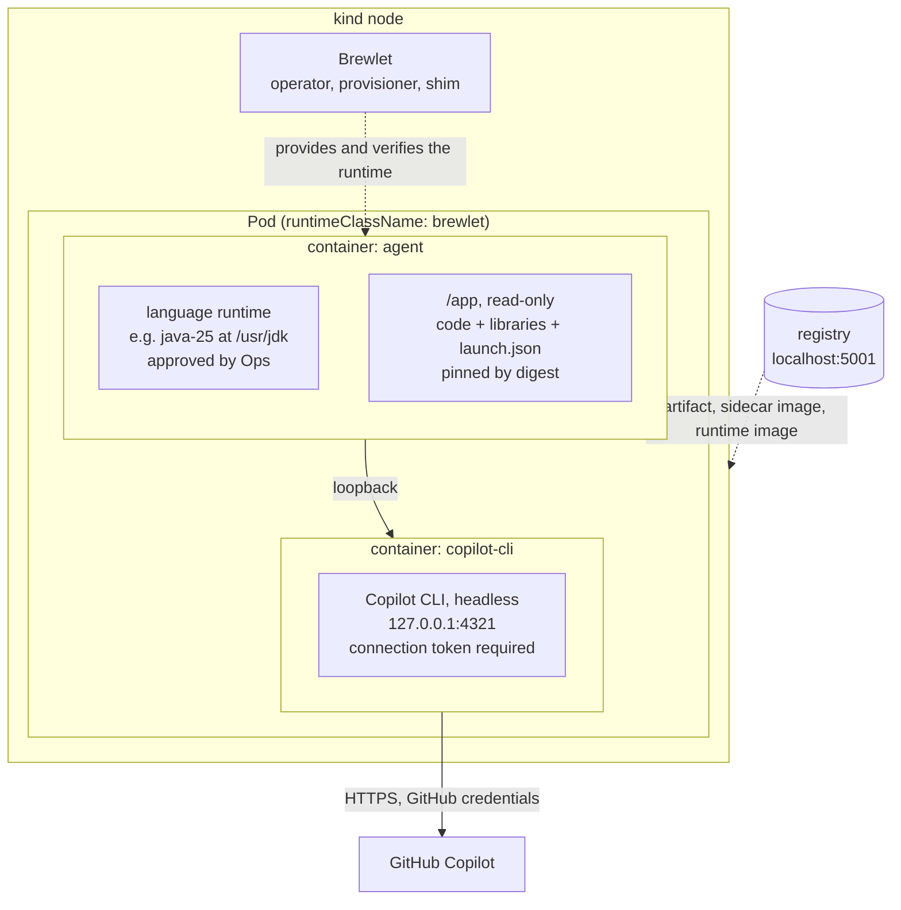
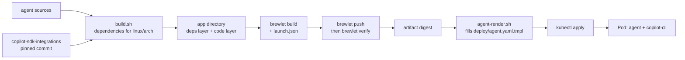
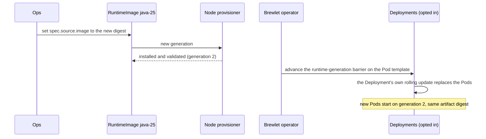

# Architecture

Three views: what a Pod is made of, how a source tree becomes that Pod, and what happens when Ops
rotates a runtime.

## One Pod



What each part is, and who is allowed to change it:

| Part | Where it comes from | Writable? | Changed by |
|------|---------------------|-----------|------------|
| Language runtime | A `RuntimeImage` approved in the cluster (`runtimes/*.env`) | No | Ops, by rotation |
| `/app` | The agent's OCI artifact, pinned by digest | No (read-only) | Developers, by publishing a new artifact |
| `/tmp` of the agent | An `emptyDir` limited to 64 MiB | Yes | The process |
| Copilot CLI | The `copilot-cli` image, started as a native sidecar | `/tmp` only | Platform, by a new image |
| GitHub credentials | A Kubernetes Secret, read by the sidecar only | n/a | You, with `make auth` |

The agent container is where Brewlet does its work. The runtime class `brewlet` and the annotation
`runtime-image.brewlet.sh/agent: <runtime id>` tell Brewlet to run the container's artifact on that
runtime; the suffix of the annotation is the container name. The sidecar has no such annotation, so it
is an ordinary OCI container on the ordinary path.

The Pod is hardened the same way for both containers (non-root, read-only root file system, no
capabilities, no privilege escalation, `RuntimeDefault` seccomp), and the `agents` namespace enforces
the Pod Security `restricted` profile. See the [security model](security.md).

## From source to Pod



| Step | Script | What matters |
|------|--------|--------------|
| Build the integrations | `scripts/integrations-build.sh` | Builds the pinned `copilot-sdk-integrations` commit for the agent's language, once. |
| Fill the app directory | `agents/<name>/build.sh` | Resolves dependencies for the **target** (`linux/<arch>` and the runtime's libc), not for your laptop. Brewlet runs no package manager. |
| Package | `scripts/agent-build.sh` | Normalizes file modes, strips macOS extended attributes, and runs `brewlet build` with the agent's `layers` file. Dependencies go in the first layer and the code in the last, so a code change pushes kilobytes. |
| Publish | `scripts/agent-publish.sh` | `brewlet push` to the local registry, then `brewlet verify` on the digest. Brewlet runs only digest-pinned applications. |
| Deploy | `scripts/agent-deploy.sh` | Renders the one Pod template every agent shares and applies it, waits for the rollout. |
| Verify | `scripts/agent-smoke.sh` | The checks of the [contract](contract.md), over a port-forward. |

The artifact is just three kinds of file. The `launch.json` is the whole contract with the runtime:

```json
{
  "schemaVersion": 1,
  "process": {
    "entrypoint": ["/usr/jdk/bin/java"],
    "args": ["-XX:MaxRAMPercentage=70", "-XX:+ExitOnOutOfMemoryError", "-jar", "/app/app.jar"],
    "workingDir": "/app"
  },
  "runtimeImages": ["java-25"]
}
```

The entrypoint is an absolute path into the runtime, because a Brewlet runtime has no shell and no
`PATH`.

## When Ops rotates a runtime



Running containers keep the generation they started with. A rotation reaches them only when they are
replaced, and replacing them is a decision with two keys: the cluster enables
`operator.rotationRestarts` (done by `make cluster` for the `agents` namespace only) and each
Deployment opts in with the `brewlet.sh/restart-on-rotation: "true"` annotation on its own metadata,
which `deploy/agent.yaml.tmpl` sets. The operator then changes nothing but the barrier annotation, and
the Deployment's rollout strategy does the rest. The [rotation demo](rotation.md) runs this end to end
and shows the artifact digests staying put.

## The platform pieces

| Piece | Lives in | Notes |
|-------|----------|-------|
| kind cluster `brewlet-agents`, one node | `cluster/kind-config.yaml` | containerd is configured to find the registry at `localhost:5001`. |
| Local registry | a Docker container, `brewlet-agents-registry` | Plain HTTP on the Docker network. Holds artifacts, the sidecar and the runtime-rotation demo image. |
| Brewlet 0.11.0 | Helm chart + node provisioner | Installed by `scripts/cluster-up.sh`; the version is `BREWLET_VERSION` in `versions.env`. |
| Runtimes | `runtimes/*.env`, registered by `scripts/runtime-register.sh` | Each pins an image digest, the interpreter path and the user id. |
| Copilot CLI sidecar | `sidecars/copilot-cli` | A distroless image with the checksum-verified CLI release. |
