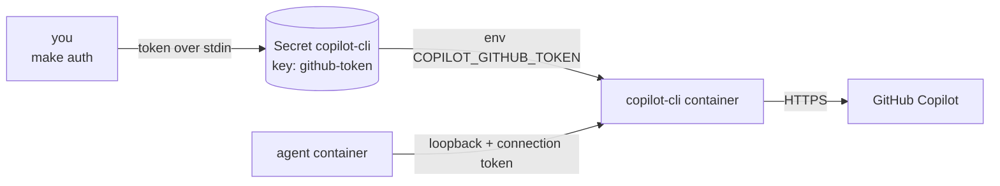

# GitHub authentication

An agent calls a model through the Copilot CLI, and the Copilot CLI needs a GitHub identity that has
Copilot access. In this project that identity lives in **exactly one place**: the `copilot-cli`
sidecar container. The agent containers never receive it.



Without credentials everything except the model call works: the Pod becomes ready, `/runtime`
answers, and `make smoke` passes. `POST /ask` returns `503 copilot_not_authenticated`. That is why
authentication is a separate, opt-in step.

## Give the sidecar a token

```bash
export COPILOT_GITHUB_TOKEN="$(gh auth token --hostname github.com)"
make auth
```

`make auth` reads the token from `$COPILOT_GITHUB_TOKEN` when it is set and from
`gh auth token --hostname github.com` otherwise (so the `export` line is optional), and writes it into the
`github-token` key of the `copilot-cli` Secret in the `agents` namespace. The token travels over stdin, so it is not
visible in a process listing and is never written to a file in this repository. The Pods that run the sidecar are
restarted afterwards, because environment variables are read when a container starts.

```bash
make ask AGENT=java-spring Q="Which JDK are you running on?"
make smoke AGENT=java-spring      # the live round trip now passes instead of being skipped
```

## Which token

| Token | Works | Notes |
|-------|-------|-------|
| Fine-grained personal access token with the **Copilot Requests** permission | Yes | The recommended choice. It can do nothing else, so a leak costs you Copilot usage and nothing more. |
| OAuth token, for example from `gh auth token` (`gho_…`) | Yes | Convenient on a laptop, and what the examples use. It carries whatever scopes your `gh` login has. |
| Classic personal access token (`ghp_…`) | **No** | Copilot does not accept them. `make auth` refuses them with a message. |

!!! warning "Use your own account's Copilot access, on purpose"
    The agent's requests are billed to the account that owns the token, like any Copilot use. For a
    demo on a shared machine, a fine-grained token with only **Copilot Requests** keeps the blast
    radius small.

## Where the token lives

| Place | Holds the token? |
|-------|------------------|
| The `github-token` key of the `copilot-cli` Secret, in kind's etcd | Yes. Kubernetes Secrets are base64, not encrypted, unless you configure encryption at rest. |
| The `copilot-cli` container's environment | Yes, as `COPILOT_GITHUB_TOKEN`. |
| The agent containers | **No.** They only get the loopback connection token. |
| Any OCI artifact or image | **No.** Not the sidecar, not an agent. |
| This repository | **No.** `make check` scans for token patterns. |

The agent and the sidecar share a different, random secret, the **connection token**
(`connection-token` in the same Secret). The sidecar refuses SDK connections that do not present it,
so another process in the Pod's network namespace cannot use the sidecar for free. It is generated when the
Secret is first needed (the first `make deploy` or `make auth`) and is not a GitHub credential.

## The Secret, as the Copilot CLI container documents it

The documentation of the Copilot CLI container
([github/copilot-cli#5554](https://github.com/github/copilot-cli/pull/5554)) describes a Kubernetes pattern, and this
project follows it:

| The documentation | Here |
|-------------------|------|
| Create the connection secret with `kubectl create secret generic … --from-literal`, which stores it without a trailing newline | The Secret `copilot-cli` holds a random `connection-token` (`openssl rand -hex 32`) stored without a trailing newline, and is created from stdin so the value is never on a command line |
| The container reads `COPILOT_CONNECTION_TOKEN` from the Secret with `secretKeyRef`; `COPILOT_GITHUB_TOKEN` is the optional GitHub identity | The sidecar reads `connection-token` and the optional `github-token` the same way; `make auth` adds the second |
| `enableServiceLinks: false`, so that a Service named `copilot` cannot override `COPILOT_PORT` | Set on the apps' Pods. No Service here is named `copilot`, so the agents' Pods do not need it |
| Rotate by updating the Secret and running `kubectl rollout restart` | [Below](#rotate-the-connection-token) |
| One replica per server: sessions live in the Pod | Every Deployment has one replica, and its own sidecar |
| Keep the Service `ClusterIP` and limit who can reach it, for example with a NetworkPolicy | The sidecar listens on the Pod's loopback interface and has no Service. The [NetworkPolicy is recommended, not installed](security.md#what-is-not-covered) |
| The connection is plain TCP without TLS | The same, which is why it never leaves the Pod |

One difference: the documentation runs the published `ghcr.io/github/copilot-cli` image. This project builds its own
sidecar image from the release tarball of the same Copilot CLI, which `versions.env` pins by version and SHA-256, and
the build fails on a mismatch. The variables it reads are the same.

### An application on `java-25-jlib` reads the token from a file

The jlib-inspector agent in the [`java-25-jlib`](observability.md#the-java-25-jlib-runtime) runtime reports every
environment variable of the process to a server that has no authentication. The
[summarizer](apps/wikipedia-summarizer.md) runs on it, so its container does not get `COPILOT_CONNECTION_TOKEN`.
Its Pod mounts the one key it needs, and Spring reads the file as configuration:

```yaml
env:
  - name: SPRING_CONFIG_IMPORT
    value: configtree:/app/secrets/
volumeMounts:
  - name: copilot-connection
    mountPath: /app/secrets
    readOnly: true
volumes:
  - name: copilot-connection
    secret:
      secretName: copilot-cli
      items:                       # without items the volume would also hold github-token
        - key: connection-token
          path: connection-token
```

`application.yml` then says `copilot.tcp-connection-token: ${connection-token}`. The `items` list matters: no container
but the sidecar may see the GitHub token. `make check` requires it on every Secret volume of an app, and fails an app
on that runtime that takes an environment variable from a Secret or names one like a credential.

## Rotate the connection token

The agents and the sidecar read the token when they start, so rotating it means updating the Secret and restarting
the Pods. The value goes in over stdin, so that it is not visible in a process listing:

```bash
export KUBECONFIG=$PWD/build/kubeconfig
printf '{"data":{"connection-token":"%s"}}' "$(openssl rand -hex 32 | tr -d '\n' | base64 | tr -d '\n')" \
  | kubectl -n agents patch secret copilot-cli --type merge --patch-file /dev/stdin
kubectl -n agents rollout restart deployment
```

The patch leaves `github-token` alone. The restart covers every Deployment in the namespace, those without a sidecar
included, which is harmless. A Pod is ready only when its application and its sidecar agree on the token, so
`kubectl -n agents rollout status deployment/<name>` returns once they do, and `make smoke AGENT=<name>` checks it.

!!! note "If a secret ever sat in an instrumented application's environment"
    jlib-server and the jlib-inspector dashboard keep in memory what the agent sent them, and that includes the
    environment. After rotating, restart both: `kubectl -n observability rollout restart deployment/jlib-server
    deployment/jlib-ui`.

## Remove it

```bash
make deauth
```

removes the `github-token` key and restarts the agents. `make down` deletes the whole cluster,
Secret included.

## Troubleshooting

| Symptom | Cause and fix |
|---------|---------------|
| `/ask` answers `503 copilot_not_authenticated` | The sidecar has no usable token. Run `make auth`, or check that the token is not a classic `ghp_` PAT. |
| `make auth` says no token was found | `gh` is not logged in and `COPILOT_GITHUB_TOKEN` is unset: run `gh auth login`, or export a fine-grained token. |
| `/ask` answers `502 agent_error` | The SDK reported a failure that is not an authentication failure, such as a model or quota error. `make logs AGENT=<name>` shows the agent's and the sidecar's logs. |
| `/readyz` answers 503 | That is the sidecar being unreachable, not an authentication problem. See [Troubleshooting](troubleshooting.md). |

For a team demo you can skip `gh` entirely: create a fine-grained token with the **Copilot Requests**
permission, then `COPILOT_GITHUB_TOKEN=<token> make auth`.
