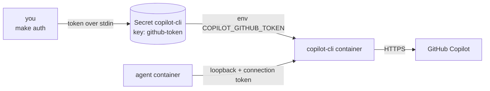

# GitHub authentication

An agent calls a model through the Copilot CLI, and the Copilot CLI needs a GitHub identity that has
Copilot access. In this project that identity lives in **exactly one place**: the `copilot-cli`
sidecar container. The agent containers never receive it.



Without credentials everything except the model call works: the Pod becomes ready, `/runtime`
answers, and `make smoke` passes. `POST /ask` returns `503 copilot_not_authenticated`. That is why
authentication is a separate, opt-in step.

## Give the sidecar a token

```bash
make auth
```

`make auth` reads the token from `$COPILOT_GITHUB_TOKEN` when it is set and from `gh auth token`
otherwise, and writes it into the `github-token` key of the `copilot-cli` Secret in the `agents`
namespace. The token travels over stdin, so it is not visible in a process listing and is never
written to a file in this repository. The agents are restarted afterwards, because environment
variables are read when a container starts.

```bash
make ask AGENT=java-spring Q="Which JDK are you running on?"
make smoke AGENT=java-spring      # the live round trip now passes instead of being skipped
```

## Which token

| Token | Works | Notes |
|-------|-------|-------|
| Fine-grained personal access token with the **Copilot Requests** permission | Yes | The recommended choice. It can do nothing else, so a leak costs you Copilot usage and nothing more. |
| OAuth token, for example from `gh auth token` (`gho_…`) | Yes | Convenient on a laptop, and what the examples use. It carries whatever scopes your `gh` login has. |
| Classic personal access token (`ghp_…`) | **No** | Copilot does not accept them. `make auth` refuses them with a message. |

!!! warning "Use your own account's Copilot access, on purpose"
    The agent's requests are billed to the account that owns the token, like any Copilot use. For a
    demo on a shared machine, a fine-grained token with only **Copilot Requests** keeps the blast
    radius small.

## Where the token lives

| Place | Holds the token? |
|-------|------------------|
| The `github-token` key of the `copilot-cli` Secret, in kind's etcd | Yes. Kubernetes Secrets are base64, not encrypted, unless you configure encryption at rest. |
| The `copilot-cli` container's environment | Yes, as `COPILOT_GITHUB_TOKEN`. |
| The agent containers | **No.** They only get the loopback connection token. |
| Any OCI artifact or image | **No.** Not the sidecar, not an agent. |
| This repository | **No.** `make check` scans for token patterns. |

The agent and the sidecar share a different, random secret, the **connection token**
(`connection-token` in the same Secret). The sidecar refuses SDK connections that do not present it,
so another process in the Pod's network namespace cannot use the sidecar for free. It is generated by
`make cluster` and is not a GitHub credential.

## Remove it

```bash
make deauth
```

removes the `github-token` key and restarts the agents. `make down` deletes the whole cluster,
Secret included.

## Troubleshooting

| Symptom | Cause and fix |
|---------|---------------|
| `/ask` answers `503 copilot_not_authenticated` | The sidecar has no usable token. Run `make auth`, or check that the token is not a classic `ghp_` PAT. |
| `make auth` says no token was found | `gh` is not logged in and `COPILOT_GITHUB_TOKEN` is unset: run `gh auth login`, or export a fine-grained token. |
| `/ask` answers `502 agent_error` | The SDK reported a failure that is not an authentication failure, such as a model or quota error. `make logs AGENT=<name>` shows the agent's and the sidecar's logs. |
| `/readyz` answers 503 | That is the sidecar being unreachable, not an authentication problem. See [Troubleshooting](troubleshooting.md). |

For a team demo you can skip `gh` entirely: create a fine-grained token with the **Copilot Requests**
permission, then `COPILOT_GITHUB_TOKEN=<token> make auth`.
