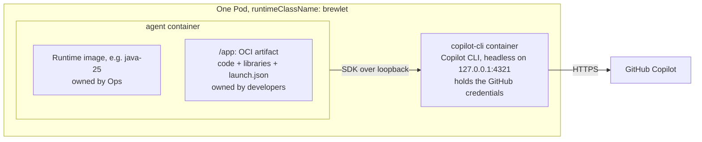

# Brewlet agents

Eight [Microsoft Copilot SDK](https://github.com/microsoft/copilot-sdk) agents in **Java, Node.js,
Python and .NET** run on a local Kubernetes cluster with [Brewlet](https://github.com/microsoft/brewlet).

## The idea in one picture

Brewlet makes the language runtime part of the platform, like the operating system or Kubernetes
itself. The application keeps being the workload. For a Copilot agent that gives three pieces with three
different owners:

-   **Runtime, owned by Ops**

    A plain, framework-agnostic image per language: `java-25`, `node-24`, `python-3.13`,
    `dotnet-10`. No framework, no Copilot SDK. Ops approves, patches and rotates it for every agent
    at once.

-   **Artifact, owned by developers**

    Code, **all** dependencies (Copilot SDK and framework integration included) and a `launch.json`.
    Layered so that a code change pushes kilobytes. No interpreter, no CLI.

-   **Copilot CLI, a sidecar**

    One image for every language. It is the only container that holds GitHub credentials, and it
    listens on the Pod's loopback interface only.

## What you can do with it

1. **Run it.** [Quickstart](quickstart.md): a cluster, Brewlet and your first agent in a few commands.
2. **Compare the frameworks.** The same [Runtime Concierge](contract.md) in Spring Boot, Quarkus,
   Micronaut, NestJS, Fastify, FastAPI, Django and ASP.NET Core, side by side in
   [the agents overview](agents/index.md).
3. **Patch the Java runtime.** Follow the [runtime rotation guide](rotation.md) to update the JDK
   for all three Java agents without rebuilding their artifacts.
4. **Summarize a Wikipedia article.** The [Wikipedia summarizer](apps/wikipedia-summarizer.md) is a Spring Boot
   agent with a REST API, and the [Node.js front-end](apps/wikipedia-frontend.md) puts a page in front of it.
5. **Watch it run.** [Observability and dashboards](observability.md): the Brewlet dashboard, the
   [jlib-inspector](apps/jlib-ui.md) dashboard for the jars each JVM loads, and an OpenTelemetry dashboard,
   fed by a custom `java-25-jlib` runtime.

## Where to read next

| If you want to know… | Read |
|----------------------|------|
| Why the Copilot CLI is a sidecar and the runtime is framework-agnostic | [Design](design.md) |
| What runs where, and how a build becomes a Pod | [Architecture](architecture.md) |
| How to let the agents call the model | [GitHub authentication](authentication.md) |
| How the apps differ from the agents, and what each one is | [Apps](apps/index.md) |
| The dashboards, and the runtime that feeds them | [Observability and dashboards](observability.md) |
| What is and is not locked down | [Security model](security.md) |
| What to do when something is stuck | [Troubleshooting](troubleshooting.md) |
| Every command, script and pinned version | [Reference](reference.md) |
