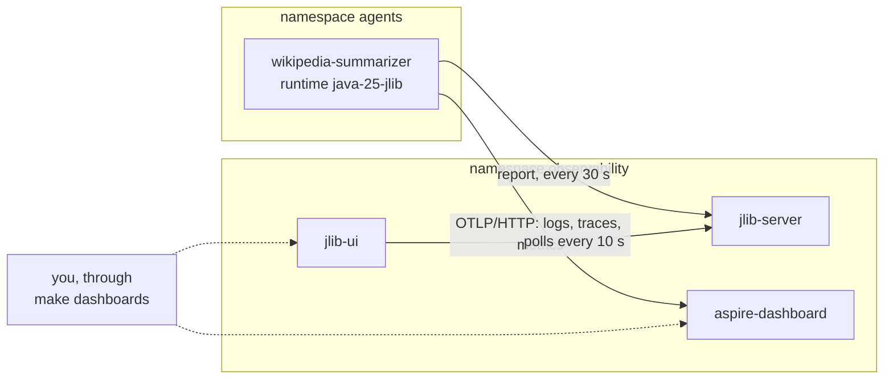

# Observability and dashboards

Three dashboards look at the platform from different sides, and one command opens them on your machine:

```bash
make observability     # once: the telemetry stack (the OpenTelemetry dashboard, the jlib-inspector server and UI)
make wikipedia         # an application on the java-25-jlib runtime, so there is something to look at
make dashboards        # opens them, until Ctrl-C
```

| Dashboard | Open | Deployed by | Signs in with | Shows |
| --- | --- | --- | --- | --- |
| **Brewlet** | `http://127.0.0.1:8088` | `make cluster` | A token valid for one hour, printed by the command | The runtimes Ops approved, the node profiles that offer them, and the workloads running on them |
| **jlib-inspector** | `http://127.0.0.1:3000` (and port 3001) | `make observability` | Nothing | The jars each Java application on `java-25-jlib` loaded, and the JVM it runs on |
| **OpenTelemetry** (Aspire) | `http://127.0.0.1:18888` | `make observability` | The token in the login link the command prints | The summarizer's traces and metrics, and the OTLP log events the jlib-inspector agent exports: one `package.info` event per jar |

`make dashboards` also forwards the [Wikipedia front-end](apps/wikipedia-frontend.md) on `http://127.0.0.1:8080`, which is
not a dashboard but is reached the same way. Every address is a port-forward to a `ClusterIP` Service: none of
these is reachable from outside your machine.

```bash
make dashboards                          # every dashboard that is deployed
make dashboards DASHBOARDS="jlib otel"   # only these: brewlet, jlib, otel, frontend
scripts/observability/dashboards.sh --check            # opens each one, requests its pages once, closes it again
```

The ports are fixed, because the jlib-inspector page connects to `ws://localhost:3001` on its own and needs 3000
and 3001 at the same numbers on your machine. If a port is taken, the command says which.

!!! warning "The tokens are secrets of your cluster"
    The Brewlet token and the Aspire login link are printed to your terminal and nowhere else. Do not paste them
    into an issue, a chat or a log. The Brewlet token expires after an hour; the Aspire token lives in the Secret
    `aspire-dashboard` until you delete it.

## How the data flows



The agent is **jlib-inspector's Java agent**. It sits in the runtime, not in the application: an application on
[`java-25-jlib`](#the-java-25-jlib-runtime) is inspected without knowing it. The agent lists every jar the JVM loads,
with its path and SHA-256, and sends that inventory to two places, each of which an application opts in to with an
environment variable:

* `JLIB_SERVER_URL`: the jlib-inspector server, which the jlib-inspector dashboard reads;
* `OTEL_EXPORTER_OTLP_ENDPOINT`: an OpenTelemetry endpoint, here the Aspire dashboard.

The report to the server also describes the process, and that includes its environment: see
[what the agent sees](#what-the-agent-sees-and-what-it-does-not). jlib-inspector's own dashboard has no
OpenTelemetry view. The agent's `otel` mode exports the same inventory as OTLP log events, and the Aspire dashboard
is what shows them. The agent sends log events only: the [traces and metrics](#traces-and-metrics-from-the-application)
come from the application itself.

## The java-25-jlib runtime

A **derived runtime**: the approved `java-25` image with the jlib-inspector agent laid over it. Agents and apps
select it by id, like any other runtime:

```yaml
annotations:
  runtime-image.brewlet.sh/app: java-25-jlib
```

Nothing else differs from `java-25`: the same distroless base, the same JDK, the same user and layout, so the id
keeps the compatibility promise `java-25` makes. [`runtimes/java-25-jlib.env`](https://github.com/brunoborges/brewlet-agents/blob/main/runtimes/java-25-jlib.env)
registers it (`BASE=java-25`) and
[`runtimes/java-25-jlib/Dockerfile`](https://github.com/brunoborges/brewlet-agents/blob/main/runtimes/java-25-jlib/Dockerfile)
builds it:

1. A first stage downloads the agent's shaded jar from the jlib-inspector release `JLIB_INSPECTOR_VERSION`, stops
   unless it has the SHA-256 in `JLIB_INSPECTOR_SHA256_AGENT` (both in `versions.env`), and stages it as
   `/opt/jlib-inspector/jlib-inspector-agent.jar`.
2. The runtime stage copies it over the `java-25` image and sets
   `JDK_JAVA_OPTIONS=-javaagent:/opt/jlib-inspector/jlib-inspector-agent.jar=otel,interval:30s`, which every `java`
   launcher reads.

The application's artifact, its `launch.json` and its Pod carry no agent. Brewlet does not inject agents: this is
Ops baking one into a runtime it approves, and anyone who wants the application on a runtime without it chooses
`java-25`.

### How it is built and approved

`make runtimes` approves it with the others. A derived runtime has no digest in git, because its digest exists only
once it has been built, so [`scripts/platform/runtime-build.sh`](https://github.com/brunoborges/brewlet-agents/blob/main/scripts/platform/runtime-build.sh)
builds it, pushes it to the local registry and records the reference in `build/runtimes/java-25-jlib/image`, and the
registration approves exactly that digest (`--insecure`, as the registry speaks plain HTTP). The image tag is a
hash of every input and of the Dockerfile, so running the build again with the same inputs reuses the image and
the digest instead of producing another one.

Rotate it like any runtime, with the reference the build printed:

```bash
scripts/platform/runtime-build.sh java-25-jlib                       # prints localhost:5001/runtimes/java-25-jlib@sha256:...
scripts/platform/runtime-rotate.sh java-25-jlib <that reference>
```

Brewlet's operator replaces the Pods of Deployments that carry `brewlet.sh/restart-on-rotation: "true"` in the
`agents` and `observability` namespaces, as it does for [any rotation](rotation.md). `make runtimes` leaves a runtime
that is already approved alone, so a changed Dockerfile or a new `java-25` base needs the two commands above.

!!! note "The Dockerfile and file modes"
    The agent's directory and jar get their modes in the first stage, and the tree is copied as it is.
    `COPY --chmod` also applies to the directories `COPY` creates, and a directory without the search bit hides the
    jar from the runtime's non-root user. The first build of this runtime had exactly that problem.

### What the agent sees, and what it does not

* **The whole process, not only the jars.** The report to the jlib-inspector server carries the JDK, the command
  line, the JVM's input arguments, **every environment variable and every system property**, and the dashboard
  lists them on the application's JVM page. The OTLP events carry the command line, the process id, the host name
  and the resource attributes, but not the environment. The agent has no option to leave any of it out, and the
  server has no authentication. An application on this runtime therefore never takes a secret from its environment,
  from a `-D` property or from an argument: it reads it from a file mounted from a Secret. The summarizer does that
  for its connection token with Spring's `configtree:` import, and `make check` fails an app on this runtime that
  has a credential-named or Secret-backed environment variable. See
  [the security model](security.md#the-observability-stack).
* **Only what the JVM has loaded.** The inventory grows as the application loads classes, and it repeats every 30 s.
  The agent also prints its report when the JVM exits.
* **JVM flags: the writable ones.** To list all of the roughly 700 flags the agent needs
  `--add-opens jdk.management/com.sun.management.internal=ALL-UNNAMED`. The runtime does not grant it: it would
  open a JDK-internal package to every application on the runtime, and the agent would then log the whole listing
  at `INFO` with every report. The dashboard shows the 16 flags that can be written, and the garbage collector
  (`SerialGC` under the summarizer's 512 Mi limit). An Ops team that wants the full list rebuilds the runtime with
  that option and silences the listing.
* **Its own log lines.** The agent logs through `java.util.logging`. Spring Boot bridges that to Logback, so the
  summarizer's Pod sets `LOGGING_LEVEL_IO_GITHUB_BRUNOBORGES_JLIB_AGENT=WARN` and quiets the `jvm` part with
  `LOGGING_LEVEL_IO_GITHUB_BRUNOBORGES_JLIB_AGENT_JVM="OFF"` (quoted, because YAML reads a bare `OFF` as a boolean).
  About thirty lines from the agent still appear in the first seconds of the log, before Spring Boot takes over.

### Reporting from another application

Run it on the runtime, and name the two back ends in its Pod, as
[the summarizer](apps/wikipedia-summarizer.md) does:

| In the Pod | Effect |
| --- | --- |
| Annotation `runtime-image.brewlet.sh/app: java-25-jlib` | The application runs on the runtime with the agent |
| `JLIB_SERVER_URL=http://jlib-server.observability.svc:8080` | The inventory goes to the jlib-inspector server |
| `OTEL_EXPORTER_OTLP_ENDPOINT=http://aspire-dashboard.observability.svc:18890` | The inventory is exported as OTLP/HTTP log events, and an application that instruments itself sends its traces and metrics to the same endpoint |
| `OTEL_SERVICE_NAME`, `OTEL_RESOURCE_ATTRIBUTES` | The name and the attributes the application appears under in the OpenTelemetry dashboard |

An application that sets neither endpoint only gets the report at exit. `make check` requires the two endpoints in
the manifest of every app on `java-25-jlib`.

## The OpenTelemetry dashboard

The [.NET Aspire dashboard](https://learn.microsoft.com/dotnet/aspire/fundamentals/dashboard/overview), running
standalone as the OTLP endpoint. It is Aspire's own image, pinned by digest in `versions.env`
(`OTEL_DASHBOARD_IMAGE`), as an ordinary container: Brewlet is for applications on a platform-owned runtime, and
this one ships with its own. [`cluster/observability/otel-dashboard.yaml`](https://github.com/brunoborges/brewlet-agents/blob/main/cluster/observability/otel-dashboard.yaml)
names the image by tag, and `scripts/observability/deploy.sh` substitutes the pinned digest when it applies the manifest
(`scripts/observability/deploy.sh --manifest` prints what is applied), so a moved tag cannot change what runs.

| Port | Service | What it is |
| --- | --- | --- |
| 18888 | `ui` | The dashboard |
| 18889 | `otlp-grpc` | OTLP over gRPC |
| 18890 | `otlp-http` | OTLP over HTTP: what the agent uses |

Open **Structured logs**, and pick the resource named after the application (`wikipedia-summarizer`). Each jar is a
`package.info` event with the attributes `package.path`, `package.version`, `package.description`,
`package.checksum` (SHA-256), `jlib.jar.path`, `jlib.jar.loaded` and `jlib.jar.nested`, and the resource carries
`service.namespace`, `k8s.namespace.name`, `k8s.pod.name` and `k8s.node.name`, besides the process's id, host name
and command line (`process.command_line`).

* **Sign-in.** The dashboard takes a browser token, from the Secret `aspire-dashboard` (key `browser-token`),
  which `make observability` generates at random on first use. `make dashboards` prints the login link. The same
  Secret holds an API key (`api-key`) for the dashboard's telemetry API, which `make telemetry` uses.
* **No persistence.** Telemetry is kept in memory: a restart of the Pod empties the dashboard, and the agent fills
  it again at its next report.
* **The OTLP receivers are open.** They accept data from any Pod that can reach them, without credentials.
  See [Security](security.md#the-observability-stack).

### Traces and metrics from the application

The agent sends log events only. The summarizer exports its own **traces** and **metrics** as well, through Spring
Boot's OpenTelemetry starter, under the same `wikipedia-summarizer` resource: one resource shows all three signals.

* **Traces.** One per request. `http post /api/summaries` has two children, `fetch article` (the request to
  Wikipedia, tagged with `wikipedia.host`) and `ask model` (the call to the Copilot CLI sidecar, tagged with
  `summarizer.truncated`), and the Copilot starter's own `copilot.agent.invocation` span (agent, model, outcome) sits
  under `ask model`. A step that fails marks its span as an error: a `404 article_not_found` shows as a failed
  `fetch article`.
* **Metrics.** The request metrics (`http.server.requests`), the JVM's (memory, garbage collection, threads,
  classes), Tomcat's and the process's, and the Copilot starter's (`copilot.agent.invocation`,
  `copilot.agent.tokens`), published every 30 seconds.
* **Not the probes.** The kubelet calls `/healthz` and `/readyz` every few seconds, which would bury the requests in
  both views, so `ProbeObservationFilter` leaves them out.
* **What they hold.** The only tags that come from a request are the Wikipedia host and whether the article was
  truncated. The article's title and text, the prompt and the summary are never recorded, and the application's own
  log lines are not exported.
* **Settings.** Every trace is kept (`management.tracing.sampling.probability: 1.0`, where Spring Boot's default
  keeps one in ten) and metrics go out every 30 seconds (`management.otlp.metrics.export.step`), both in the
  application's `application.yml`. Where to send them, and under which name, comes from the `OTEL_*` variables the
  Pod already sets for the agent: Spring Boot maps them to its own properties.
* **Turning them off.** Set `OTEL_TRACES_EXPORTER=none` and `OTEL_METRICS_EXPORTER=none`. Run on your machine with
  no collector listening, the application logs a warning every 30 seconds from its metrics exporter: set both to
  stop it, or point `OTEL_EXPORTER_OTLP_ENDPOINT` at a collector.

## The jlib-inspector server and dashboard

[`jlib-server`](apps/jlib-server.md) collects the agents' reports and [`jlib-ui`](apps/jlib-ui.md) shows them. Both
are apps in the `observability` namespace, built from jlib-inspector releases pinned by checksum or by commit, on
the `java-25` and `node-24` runtimes. Their pages list what each exposes and what to watch for; in short:

* the data is in memory, and applications reappear within 30 seconds of a restart;
* neither has authentication, and the UI can be pointed at another server by anyone who reaches it;
* the UI's page needs port 3001 as well as 3000, and an internet connection for two CDN scripts.

## The Brewlet dashboard

Brewlet's own view of the platform. `make cluster` installs Brewlet from its Helm chart with the dashboard enabled
(and the Prometheus metrics Services), which gives Service `brewlet-dashboard` on port 8088 in the `brewlet`
namespace. It is an experimental feature of Brewlet.

Its views are the runtime images (approval, generation and digest, and the node profiles that offer them), the
details of one runtime (the generations in use and the generation each Pod runs), the node profiles, the nodes and
the events. This is where `java-25-jlib` shows next to `java-25` and `node-24`, and where a [rotation](rotation.md)
shows as a new generation.

It signs in with a Kubernetes bearer token and acts with that token's permissions, never with its own. `make
dashboards` creates, once, a ServiceAccount `runtime-reader` in the `brewlet` namespace and binds it to the chart's
`brewlet-dashboard-viewer` role through the ClusterRoleBinding `runtime-reader-view`, and mints a token for it that
is valid for one hour. Paste the token into the sign-in form.

* The role can only read: RuntimeImages, NodeProfiles, nodes, Pods, events and workload controllers, in every
  namespace. Rotating from the dashboard needs `dashboard.allowWrite=true` in the chart and a second role, and
  neither is set up here: use `scripts/platform/runtime-rotate.sh`.
* The page refuses to take a token over plain HTTP from anywhere but `localhost`, which is why the way in is a
  port-forward. It keeps the token in memory only, so reloading the page asks for it again.

## Check that data flows

An environment variable proves nothing about export, so `make telemetry` reads the data back from both back ends:

```text
==> applications that reported to jlib-server
  468b02d91d72  79 jars  Microsoft 25.0.5.1  (unnamed)  /usr/jdk/bin/java -XX:MaxRAMPercentage=70 ...
==> resources that exported OTLP to aspire-dashboard
  wikipedia-summarizer: 378 package.info events
==> resources that also exported traces and metrics to aspire-dashboard
  wikipedia-summarizer: traces and metrics
 ok telemetry flows: the applications reported to jlib-server and exported logs, traces and metrics to aspire-dashboard
```

It asks the jlib-inspector server through the API server's Service proxy, and the Aspire dashboard through its
telemetry API. A report arrives when the JVM starts and then every 30 seconds, and the summarizer publishes its
metrics at the same interval, so right after `make wikipedia` it polls for up to 90 seconds (`TELEMETRY_TIMEOUT`)
and fails if a back end has nothing by then: no jlib-inspector report, no `package.info` event, or no resource with
both traces and metrics. Traces need a request, which the smoke test of `make wikipedia` sends, and so does
`make summarize`. The event count grows with every report. The application shows as `(unnamed)` in the
jlib-inspector dashboard because the agent does not send a name; you can name it there.

## Before you use it on a shared cluster

This stack is for a local cluster. The services in it have no authentication, the OTLP receivers accept anyone,
and nothing restricts which Pods may reach them, and the inventory they hold lists every library each application
runs. [Security](security.md#the-observability-stack) lists the gaps and what to do about each.
