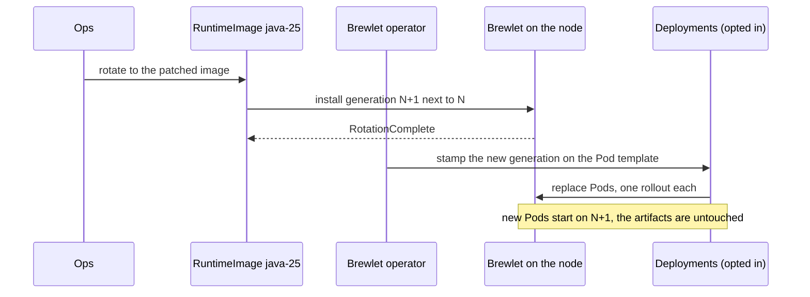

# Patch day: rotating the runtime

The claim behind the whole design is that **Ops can patch a language runtime once, and every agent on
it moves, without being rebuilt**. This page shows it on the three Java agents, which share the
`java-25` runtime, and says what it does not do.

## The scenario

A JDK security update ships. In a world where every service image carries its own JDK, each team
rebuilds, re-scans, re-pushes and re-deploys, in whatever order they get to it.

Here, the agent artifacts hold no JDK. `java-25` is a `RuntimeImage` that Ops approved, and the three
Java agents (Spring Boot, Quarkus and Micronaut) declare that they run on it. Patch day is one
operation on that one object:



## Run it

Deploy the three Java agents, then:

```bash
make agent AGENT=java-spring
make agent AGENT=java-quarkus
make agent AGENT=java-micronaut

make rotate-status   # the JDK every agent runs on, next to the artifact it runs
make rotate          # rewind java-25 to an older JDK ("last quarter"), then patch it back
```

`make rotate` is `scripts/demos/rotation.sh all`. For a live demo, rewind beforehand and patch on
stage:

```bash
scripts/demos/rotation.sh previous    # before the audience arrives
scripts/demos/rotation.sh current     # the demo: patch day
```

## What to look at

`make rotate-status` prints one line per agent. Three columns tell the story:

| Column | Where it comes from | What happens to it |
|--------|---------------------|--------------------|
| JDK | The running process, asked through the agent's `/runtime` endpoint | Changes: the new Pods run on the patched JDK |
| GEN | The runtime generation the agent's Pod runs on, from the `RuntimeImage` status | Goes up by one per rotation |
| ARTIFACT | The digest of the artifact in the Pod (`brewlet.sh/artifact-digest`) | **Does not change.** Nobody rebuilt the app |

The unchanged artifact digest is the proof. A digest is a hash of the artifact's contents, so the same
digest before and after means the same bytes.

## Real output

One run on the reference setup: a single-node `kind` cluster on an Apple-silicon laptop, with the three
Java agents deployed. The generation numbers are those of a fresh cluster. The three artifact digests are
the ones to compare with each other; the digest of the runtime image will differ on your machine, because
`make rotate` builds the older JDK locally.

Before, with `make rotate-status`:

```text
==> runtime java-25: generation 1, image sha256:e84386716537
  AGENT            JDK (live, from /runtime)  GEN  ARTIFACT (the app's own bytes)
  java-micronaut   25.0.5.1+2-LTS Microsoft   1    sha256:1f6cfd677d3e
  java-quarkus     25.0.5.1+2-LTS Microsoft   1    sha256:cf9b8898d7db
  java-spring      25.0.5.1+2-LTS Microsoft   1    sha256:86643a3e65fe
```

"Last quarter", with `scripts/demos/rotation.sh previous` (19 seconds for the whole script):

```text
==> runtime java-25: generation 2, image sha256:717f479547da
  AGENT            JDK (live, from /runtime)  GEN  ARTIFACT (the app's own bytes)
  java-micronaut   25.0.4.1+1-LTS Microsoft   2    sha256:1f6cfd677d3e
  java-quarkus     25.0.4.1+1-LTS Microsoft   2    sha256:cf9b8898d7db
  java-spring      25.0.4.1+1-LTS Microsoft   2    sha256:86643a3e65fe
```

Patch day, with `scripts/demos/rotation.sh current` (22 seconds):

```text
==> runtime java-25: generation 3, image sha256:e84386716537
  AGENT            JDK (live, from /runtime)  GEN  ARTIFACT (the app's own bytes)
  java-micronaut   25.0.5.1+2-LTS Microsoft   3    sha256:1f6cfd677d3e
  java-quarkus     25.0.5.1+2-LTS Microsoft   3    sha256:cf9b8898d7db
  java-spring      25.0.5.1+2-LTS Microsoft   3    sha256:86643a3e65fe
```

Between the tables, the Brewlet CLI says what the patch day will touch before it writes anything (this is
the patch-day report, trimmed):

```text
Rotation impact for java-25
  from: localhost:5001/runtimes/java-25@sha256:717f479547da…
  to:   mcr.microsoft.com/openjdk/jdk@sha256:e843867165371f…
Nodes converging to the new generation (1):
  brewlet-agents-control-plane (profile local, linux/arm64, Eager, current generation 2)
Workloads selecting java-25 (3):
  Deployment agents/java-micronaut: rolling restart: operator advances a runtime-generation.brewlet.sh/<id> barrier; the controller rolls per its update strategy
  Deployment agents/java-quarkus: rolling restart: …
  Deployment agents/java-spring: rolling restart: …
Live pods on the current generation (3): keep running; pick up the new generation only when restarted
```

A few seconds later, `brewlet k8s runtime status java-25` shows the operator at work:

```text
  TYPE                 STATUS  REASON                            MESSAGE
  RotationComplete     True    ParticipantsCurrent               … generation=3 digest=sha256:e84386716537…
  OldGenerationTasks   True    ObservedOlderOrForeignEpochTasks  3 actual task/lease bindings remain; …

Restarts: pending=0 rolling=3 complete=0 deferred=0 notApplicable=0 failed=0
  WORKLOAD                          GENERATION  PHASE    REASON              MESSAGE
  Deployment agents/java-spring     3           Rolling  RestartProgressing  template barrier installed; observing workload controller

Bound containers (task observations, 3):
  POD                                     CONTAINER  NODE                          GENERATION  STATE
  agents/java-micronaut-754b9bf8b7-nhpff  agent      brewlet-agents-control-plane  2 (old)     running
```

Two lines in that output carry the whole idea:

* `RotationComplete` is already `True` while `OldGenerationTasks` is too. The new generation is installed
  on the node *next to* the old one; the running agents keep the generation they started with (`2 (old)`)
  until their Deployments roll. Nothing is swapped under a running process.
* The artifact digests are identical in all three tables. Nobody built, pushed or deployed an agent.

### Did traffic notice?

While those two rotations ran, a loop polled `/healthz` on each of the three agents through its Service,
about twice a second each: **574 requests, none failed.** That is what the Deployment's default rolling
update gives a single replica: the new Pod starts next to the old one (`maxSurge` 25% rounds up to one
extra Pod, `maxUnavailable` 25% rounds down to zero), and the old Pod leaves only after the new one is
Ready.

Repeat it in a second terminal while `make rotate` runs. It prints only failures, so silence is the
good result:

```bash
export KUBECONFIG=$PWD/build/kubeconfig PATH=$PWD/.bin:$PATH
while sleep 0.2; do
  kubectl get --raw /api/v1/namespaces/agents/services/java-spring:80/proxy/healthz >/dev/null 2>&1 \
    || echo "FAIL $(date +%T)"
done
```

!!! note "What this shows, and what it does not"
    It shows that the Service always had a ready Pod to answer a health check, with one replica on one node.
    It does not cover a `POST /ask` that is in flight at the moment its Pod is replaced, and a model call
    can take several seconds.

`make rotate` may also print a `DigestMismatch` note and a line that says `asking again`. Both are
harmless; [troubleshooting](troubleshooting.md#rotation) says why.

## How the Pods follow

Rotating a `RuntimeImage` installs a new generation on the node, and that is all. Pods that are already
running keep the generation they started with; only Pods started afterwards get the new one. Something
has to restart the agents, and Brewlet makes that an explicit opt-in on two levels:

| Opt-in | Where | Set by |
|--------|-------|--------|
| `operator.rotationRestarts.enabled=true` (and, optionally, `namespaces`) | The Helm release of Brewlet | `scripts/platform/cluster-up.sh`, for the `agents` and `observability` namespaces |
| `brewlet.sh/restart-on-rotation: "true"` | The metadata of the **Deployment** | each `agents/<name>/deployment.yaml` and `apps/<name>/deployment.yaml`, so every agent and app has it |

With both set, the operator stamps the new generation on the Pod template of every Deployment that
runs on the rotated runtime. That is an ordinary template change, so the Deployment's own rollout
strategy replaces the Pods: surge, readiness gates and rollback behave as they always do. The operator
works through up to five workloads at a time and gives each ten minutes to make progress. It never
touches `kube-system`, `kube-public` or `kube-node-lease`, and it needs Kubernetes 1.30 or newer.

Without the opt-in, restart the agents yourself and they pick up the new generation:

```bash
kubectl -n agents rollout restart deployment
```

`scripts/demos/rotation.sh` waits a minute for the operator, and does exactly that if the operator did
not act.

!!! note "A derived runtime is rotated on its own"
    `java-25-jlib` is built from `java-25`, but it is a `RuntimeImage` of its own. Rotating `java-25` moves the
    Java agents and jlib-server; the Wikipedia summarizer stays on its generation of `java-25-jlib` until Ops builds
    that runtime again on the patched base and rotates it
    ([how](observability.md#how-it-is-built-and-approved)).

## Try it by hand

Underneath the scripts are two Brewlet commands and a status object:

```bash
brewlet k8s runtime rotate java-25 --image <image-or-digest> --yes
brewlet k8s runtime status java-25
kubectl get runtimeimage java-25 -o yaml
```

`scripts/platform/runtime-rotate.sh` adds the one thing a script needs: it waits until the new generation is
installed *and* `RotationComplete` has seen the current spec, because waiting on the generation alone
would race the condition left over from the previous rotation.

## What it does not fix

!!! warning "A rotation patches the runtime, not the agent"
    Brewlet states it plainly: **runtime rotations never remediate dependency copies packaged by the
    application under `/app`.** The JDK moves; the Spring, Quarkus and Micronaut jars inside each
    artifact do not. A vulnerable library in an agent artifact is fixed by rebuilding that artifact, with
    `make agent`.

That is the division of labor the design is about, and the reason there are two kinds of patch day:

| Vulnerable component | Owned by | The fix | Touches the agent artifact? |
|----------------------|----------|---------|-----------------------------|
| The JDK, Node.js, CPython or .NET | Ops (the runtime) | Rotate the `RuntimeImage` | No |
| A framework or library in the agent | The developer (the artifact) | Rebuild and redeploy the artifact | Yes |
| The Copilot CLI | Ops (the sidecar) | Publish a new sidecar image (`make sidecar`) and redeploy each agent (`make deploy AGENT=…`) | No rebuild |

A runtime id is a promise that Ops keeps: across rotations the ecosystem, the ABI, the user and the file
layout stay the same, and an incompatible change gets a new id so that no agent is moved onto it by
surprise.
