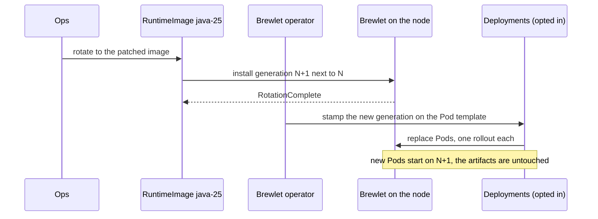

# Patch day: rotating the runtime

The claim behind the whole design is that **Ops can patch a language runtime once, and every agent on
it moves, without being rebuilt**. This page shows it on the three Java agents, which share the
`java-25` runtime, and says what it does not do.

## The scenario

A JDK security update ships. In a world where every service image carries its own JDK, each team
rebuilds, re-scans, re-pushes and re-deploys, in whatever order they get to it.

Here, the agent artifacts hold no JDK. `java-25` is a `RuntimeImage` that Ops approved, and the three
Java agents (Spring Boot, Quarkus and Micronaut) declare that they run on it. Patch day is one
operation on that one object:



## Run it

Deploy the three Java agents, then:

```bash
make agent AGENT=java-spring
make agent AGENT=java-quarkus
make agent AGENT=java-micronaut

make rotate-status   # the JDK every agent runs on, next to the artifact it runs
make rotate          # rewind java-25 to an older JDK ("last quarter"), then patch it back
```

`make rotate` is `scripts/demo-rotation.sh all`. For a live demo, rewind beforehand and patch on
stage:

```bash
scripts/demo-rotation.sh previous    # before the audience arrives
scripts/demo-rotation.sh current     # the demo: patch day
```

## What to look at

`make rotate-status` prints one line per agent. Three columns tell the story:

| Column | Where it comes from | What happens to it |
|--------|---------------------|--------------------|
| JDK | The running process, asked through the agent's `/runtime` endpoint | Changes: the new Pods run on the patched JDK |
| GEN | The runtime generation the agent's Pod runs on, from the `RuntimeImage` status | Goes up by one per rotation |
| ARTIFACT | The digest of the artifact in the Pod (`brewlet.sh/artifact-digest`) | **Does not change.** Nobody rebuilt the app |

The unchanged artifact digest is the proof. A digest is a hash of the artifact's contents, so the same
digest before and after means the same bytes.

## How the Pods follow

Rotating a `RuntimeImage` installs a new generation on the node, and that is all. Pods that are already
running keep the generation they started with; only Pods started afterwards get the new one. Something
has to restart the agents, and Brewlet makes that an explicit opt-in on two levels:

| Opt-in | Where | Set by |
|--------|-------|--------|
| `operator.rotationRestarts.enabled=true` (and, optionally, `namespaces`) | The Helm release of Brewlet | `scripts/cluster-up.sh` |
| `brewlet.sh/restart-on-rotation: "true"` | The metadata of the **Deployment** | `deploy/agent.yaml.tmpl`, so every agent has it |

With both set, the operator stamps the new generation on the Pod template of every Deployment that
runs on the rotated runtime. That is an ordinary template change, so the Deployment's own rollout
strategy replaces the Pods: surge, readiness gates and rollback behave as they always do. The operator
works through up to five workloads at a time and gives each ten minutes to make progress. It never
touches `kube-system`, `kube-public` or `kube-node-lease`, and it needs Kubernetes 1.30 or newer.

Without the opt-in, restart the agents yourself and they pick up the new generation:

```bash
kubectl -n agents rollout restart deployment
```

`scripts/demo-rotation.sh` waits a minute for the operator, and does exactly that if the operator did
not act.

## Try it by hand

Underneath the scripts are two Brewlet commands and a status object:

```bash
brewlet k8s runtime rotate java-25 --image <image-or-digest> --yes
brewlet k8s runtime status java-25
kubectl get runtimeimage java-25 -o yaml
```

`scripts/runtime-rotate.sh` adds the one thing a script needs: it waits until the new generation is
installed *and* `RotationComplete` has seen the current spec, because waiting on the generation alone
would race the condition left over from the previous rotation.

## What it does not fix

!!! warning "A rotation patches the runtime, not the agent"
    Brewlet states it plainly: **runtime rotations never remediate dependency copies packaged by the
    application under `/app`.** The JDK moves; the Spring, Quarkus and Micronaut jars inside each
    artifact do not. A vulnerable library in an agent artifact is fixed by rebuilding that artifact, with
    `make agent`.

That is the division of labor the design is about, and the reason there are two kinds of patch day:

| Vulnerable component | Owned by | The fix | Touches the agent artifact? |
|----------------------|----------|---------|-----------------------------|
| The JDK, Node.js, CPython or .NET | Ops (the runtime) | Rotate the `RuntimeImage` | No |
| A framework or library in the agent | The developer (the artifact) | Rebuild and redeploy the artifact | Yes |
| The Copilot CLI | Ops (the sidecar) | Publish a new sidecar image (`make sidecar`) and redeploy each agent (`make deploy AGENT=…`) | No rebuild |

A runtime id is a promise that Ops keeps: across rotations the ecosystem, the ABI, the user and the file
layout stay the same, and an incompatible change gets a new id so that no agent is moved onto it by
surprise.
